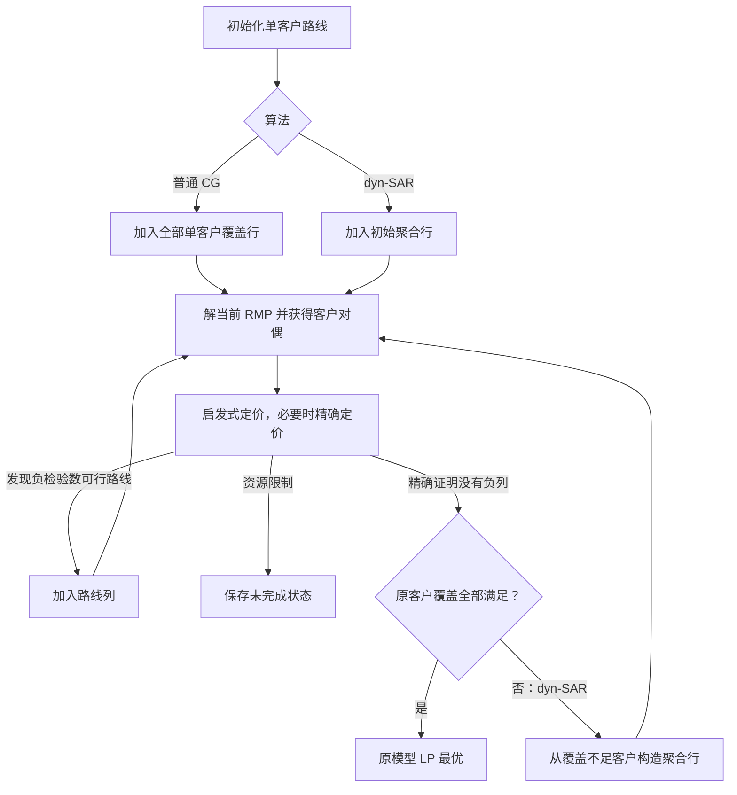

# VRPTW：普通列生成与 dyn-SAR

这是根据 Costa et al. (2022) 第 3 节和第 4.1 节独立编写的可运行实现。解的是 **VRPTW 路线集合覆盖模型的 LP 松弛**。包含容量、客户时间窗、服务时间、回仓时间和路线内不重复访问约束。

两种算法使用相同的数据、单客户初始路线、增量 LP 求解器和定价器：

| 版本 | 初始行 | 迭代过程 | 最优性终止条件 |
|---|---|---|---|
| 普通列生成 `standard` | 每位客户一条覆盖约束 | 解 RMP → 取对偶 → 定价 → 加路线列 | 精确定价证明没有负检验数路线 |
| 论文方法 `dyn-sar` | 少量聚合覆盖约束 | 将当前 EMP 列生成到收敛 → 找覆盖不足客户 → 加聚合行 → 继续 | 当前 EMP 已收敛，而且每位客户均被覆盖 |

下载的 `instances-ijoc-dyn-sar-main` 仓库只提供实例数据，不含作者求解器源码。本目录是独立参考实现。它复现 dyn-SAR 的数学模型及 VRPTW 行初始化/分离机制，但没有复现作者的全部底层性能优化。具体差异见下文。

## 1. 下载、安装和运行

需要 Python 3.10 或更新版本。以下为 Windows PowerShell 命令：

```powershell
git clone https://github.com/AzureLong64/vrptw-column-generation.git
Set-Location vrptw-column-generation
python -m venv .venv
& '.\.venv\Scripts\python.exe' -m pip install -r requirements.txt
& '.\.venv\Scripts\python.exe' -m pip install -e '.[test]'
& '.\.venv\Scripts\python.exe' -m vrptw_cg demo
```

这会运行两种算法，并独立枚举 6 客户实例的全部可行路线，比较 LP 最优值。正确输出包含：

```text
EXHAUSTIVE REFERENCE: z=24.787177664; both algorithms match=True
```

Linux/macOS 可使用 `python3 -m venv .venv` 创建环境，将后续解释器路径换成 `.venv/bin/python`。虚拟环境不包含在仓库里，需要在本机建立。

仓库包含自制的 6 客户教学实例。运行下面的 Homberger 实验前，请将[作者的数据仓库](https://github.com/lucianoccosta/instances-ijoc-dyn-sar) 下载到本项目的同级目录：

```powershell
git clone https://github.com/lucianoccosta/instances-ijoc-dyn-sar.git ../instances-ijoc-dyn-sar-main
```

数据和论文 PDF 不随本代码仓库分发。没有外部数据目录时，单元测试会跳过两项真实数据测试，其余 28 项仍可独立运行。仓库保留了经核对的结果摘要以及 R1_2_1 的逐轮日志；完整 `result.json` 和其他运行文件由程序在本地生成。

运行完整 200 客户实例，并给每种算法分别设置 120 秒预算：

```powershell
& '.\.venv\Scripts\python.exe' -m vrptw_cg compare --instance '..\instances-ijoc-dyn-sar-main\VRPTW\homberger_200_customer_instances\R1_2_1.TXT' --time-limit 120 --output results/my_r1_200
```

单独运行普通列生成或 dyn-SAR：

```powershell
& '.\.venv\Scripts\python.exe' -m vrptw_cg solve --algorithm standard --instance '..\instances-ijoc-dyn-sar-main\VRPTW\homberger_200_customer_instances\R1_2_1.TXT' --output results/my_standard
& '.\.venv\Scripts\python.exe' -m vrptw_cg solve --algorithm dyn-sar --instance '..\instances-ijoc-dyn-sar-main\VRPTW\homberger_200_customer_instances\R1_2_1.TXT' --output results/my_dyn_sar
```

用之前讨论的 R2_2_5 数据学习，每次先取 8 或 20 位客户：

```powershell
& '.\.venv\Scripts\python.exe' -m vrptw_cg validate --instance '..\instances-ijoc-dyn-sar-main\VRPTW\homberger_200_customer_instances\R2_2_5.TXT' --limit-customers 8 --output results/my_r2_8
& '.\.venv\Scripts\python.exe' -m vrptw_cg compare --instance '..\instances-ijoc-dyn-sar-main\VRPTW\homberger_200_customer_instances\R2_2_5.TXT' --limit-customers 20 --output results/my_r2_20
```

`--limit-customers` 明确构造一个较小的新实例，保留最小的 N 个客户编号，容量和时间窗不变。这些结果不能称为完整 200 客户实例的结果。移除此参数即可运行完整实例；宽时间窗实例的精确定价可能较慢。

同一 `--output` 下的同名算法结果会被本次运行覆盖；保留历史实验时请使用不同输出目录。

## 2. 两种算法究竟解什么

设 Ω 是所有满足容量和时间窗的 elementary routes，即一条路线中每位客户最多访问一次。路线从仓库出发并返回仓库。aᵢᵣ 表示路线 r 是否访问客户 i，cᵣ 是其欧氏距离总和。

普通列生成求解：

```text
min  Σᵣ cᵣ θᵣ
s.t. Σᵣ aᵢᵣ θᵣ ≥ 1              对每位客户 i
     θᵣ ≥ 0
```

变量 θᵣ 是连续变量，可能等于 0.5。一列是一整条可行路线，不是一条道路边。初始列是 `0 → i → 0`，以后由定价器动态发现更有价值的路线；求解过程没有预先枚举全部路线。

当前 RMP 的客户对偶为 πᵢ。路线检验数为：

```text
reduced_cost(r) = cᵣ − Σᵢ∈r πᵢ
```

定价器寻找检验数小于 `−1e−7` 的可行路线，加回 RMP。只有完整精确定价确认不存在这种路线，才确认当前行集合对应的 LP 已解完。启发式没有找到路线不构成最优性证明。

对 dyn-SAR，当前只保存聚合集合族 S，每个集合对应论文式 (10)：

```text
Σᵣ (|r ∩ S| / |S|) θᵣ ≥ 1        对每个当前集合 S
```

聚合行对偶 γ_S 按论文式 (13) 分配给客户：

```text
πᵢ = Σ_{S 包含 i} γ_S / |S|
```

因此两个版本可以共用定价器。如果两个集合相交，一个客户会收到来自多个聚合行的对偶贡献。

当当前 EMP 的列生成收敛后，计算每位客户的覆盖量 `yᵢ = Σᵣ aᵢᵣ θᵣ`。若仍有 `yᵢ < 1−1e−7`，按论文机制加入被违反的聚合行。**这不是把原集合强制拆成互不相交的小集合**：原聚合行保留，新行可以重叠。

当所有 yᵢ ≥ 1 时，当前解对原始 MP 可行；它同时达到一个松弛 EMP 的最优值，因此达到原 MP 的 LP 最优值。程序不要求最终出现全部单客户行。



## 3. 与论文 VRPTW 实现的对应关系

| 论文内容 | 本实现 | 代码 |
|---|---|---|
| 第 3 节 Algorithm 1 | 解完当前 EMP，再分离行，保留历史行和列 | `dyn_sar.py` |
| 式 (10)、(13) | 行系数取平均、γ → π 映射 | `master.py` |
| 4.1.1 单客户路线初始化 | 两个版本都使用 n 条单客户路线 | `master.py` |
| 4.1.1.1 初始聚合 | 按到仓库的距离排序，分组大小 20、40、80…… | `aggregation.py:initial_groups` |
| 4.1.1.2 偏置距离 | dᵢⱼ^max(1,d₀ᵢ/d₀ⱼ)，取 n/4 个邻居 | `aggregation.py:biased_neighborhoods` |
| 被违反集合 | 中心客户加上邻域中约 ℓ 个覆盖不足客户，按违反度选 | `aggregation.py:separate_rows` |
| 当前基中的平均路线大小 ℓ | 读取 HiGHS 的真实 simplex basis；包含值为 0 的基路线变量 | `master.py:mean_basis_route_size` |
| 最大分散选择 | 对最违反的 n/4 个候选集合，贪心最大化最小对称差 | `aggregation.py:separate_rows` |
| 每轮加行上限 | 最多 5% × n；小实例至少允许 1 行 | `aggregation.py:separate_rows` |
| 每次最多 300 列 | 两个版本一致；同一覆盖集合保留最便宜的已知访问顺序 | `pricing.py`、`master.py` |
| elementary 定价与 DSSR | 单向标号 + 逐步收紧记忆集合，最终列一定没有重复客户 | `pricing.py:exact` |

论文未完整指定的取整和并列规则在这里固定为：ℓ 向上取整；n/4 和 5%n 向下取整且至少 1；优先最违反集合，后续最大化与已选集合的最小对称差；并列按违反度、客户编号打破。违反度是归一化聚合行的缺口，即集合内平均 `1−yᵢ`。同坐标邻居距离记为 0；客户在仓库坐标导致 d₀ⱼ=0 时，分母取 1e−12。

这些是公开可审查的实现选择，不能声称与未公开作者代码逐步完全一致。

### 共用定价器的执行顺序

1. 从各客户出发的贪心延伸，优先加入可行且能降低检验数的下一位客户。
2. 在每位客户约 5 条近邻入/出边的缩减网络上标号搜索。
3. 在约 10 条近邻入/出边的缩减网络上标号搜索。
4. 在完整可行弧网络上调用精确 DSSR 定价。

前三步只负责快速找列，找到后返回 RMP；只有需要时才调用第 4 步。`--no-heuristics` 可以直接观察精确定价的列生成流程。

DSSR 初始允许未被记忆的客户重复访问，以减小状态空间。如果发现负检验数的重复访问路径，就把其中重复的客户加入记忆集合，再解更严格的子问题。每一个中间搜索空间都包含全部 elementary routes，因此“更宽松的搜索空间中没有负路线”可以证明 elementary pricing 中也没有。重复访问路径始终不会进入主问题。另加最多 n 次访问的限制，保证即使存在零需求、零服务时间和重合坐标，松弛搜索仍然有限；它不会排除 elementary routes。

实现包含时间、容量、访问状态和访问次数的安全支配，以及基于三角不等式的乐观收益界。`pricing.py:labels` 不传 `critical_mask` 时也支持直接保存全部访问历史的 elementary 标号搜索，供小实例交叉验证。

### 与作者求解器的主要差异

- 本实现使用 Python + HiGHS，作者实验使用 GENCOL 和其 LP 求解环境。
- 本实现使用单向标号和 DSSR，没有实现论文的双向时间标号、ng-route 邻域机制和 tabu search；第一层启发式用贪心延伸替代。
- 缩减网络标号另设 beam 和时间/标签数上限。其结果只用来找列，不用于证明没有负列。
- 没有加入额外有效不等式、分支定界或整数恢复；没有实现论文中其他问题 BPPC、MPPEP。

因此，这一版本适合学习真实列生成流程、检查数学正确性和继续研究，不是论文实验表格的性能复刻。换求解器、定价实现、退化基选择和微小启发式参数，都会改变中间路线、对偶、迭代数和总耗时。

## 4. 模型约定和结果边界

- 路线成本和行驶时间均为未舍入欧氏距离，服务时间单独加入到时钟中。早到等待，到达后服务开始时间不能晚于客户窗口右端；服务完成允许晚于该端点。返回仓库不得晚于仓库窗口右端。
- 数据文件中的 `NUMBER` 仅保留为车辆数元数据。当前模型按论文展示的集合覆盖 LP 建模，**没有车队数量约束**，也不做车辆数/距离的词典序优化。
- `θ` 连续，因此 `optimal_lp` 是此模型的 LP 最优，不能当成整数 VRPTW 最优或直接执行的车辆调度。`active_routes.csv` 中的 `value` 是路线权重。
- 没有把列变量额外限制为 θ≤1。特别是在仅有聚合行的中途，某条单客户路线的权重可能超过 1，这是聚合松弛的正常行为。
- 同一客户集合的不同访问顺序有相同列系数；只需保存已经发现的最便宜顺序。出现更便宜顺序时更新该列成本。
- 用浮点 LP 和 1e−7 检验数/覆盖容差判定最优，不是有理数精确算术证书。

## 5. 如何阅读输出

每个算法目录保存：

| 文件 | 用途 |
|---|---|
| `result.json` | 最终状态、最优值、上下界、路线、覆盖量、客户对偶、聚合集合、参数 |
| `iterations.csv` | 每次 RMP 求解后的目标值、行/列数、覆盖不足人数、定价类型、新列数和耗时 |
| `events.jsonl` | 实时追加的逐轮事件，包含每次加行的具体客户集合 |
| `active_routes.csv` | 最后一次已求解 RMP 中权重为正的路线及其成本、载重、回仓时间 |
| 上级 `summary.json` | 两算法对照；小实例额外包含枚举参考值 |

终端默认只打印首轮、每 10 轮、每次 EMP 收敛及加行/结束事件。所有迭代仍保存在文件中。

`iterations` 统计解 RMP 的次数，一轮中可能调用多个定价启发式；`pricing_calls` 按定价类型单独计数。`generated_columns` 包含初始 n 条路线，`generated_rows` 包含初始行。`outer_rounds` 是解 EMP 的轮数，成功结束时加行轮数通常是它减 1。

特别注意以下字段：

| 字段/状态 | 含义 |
|---|---|
| `status: optimal_lp`，`certified_optimal: true` | 精确定价结束且原客户覆盖成立，确认原模型 LP 最优 |
| `lp_optimum: null` | 未确认 LP 最优，不应引用 `last_rmp_objective` 作为最终最优值 |
| `time_limit` / `pricing_time_limit` / `pricing_label_limit` | 达到总体时间、单次精确定价时间或标签总量限制 |
| `iteration_limit` | 达到 RMP 迭代上限 |
| `last_rmp_objective` | 最后一次已解出的受限主问题目标值 |
| `certified_emp_lower_bound` | 只在完整精确定价结束时更新；是原 MP 的 LP 下界，可能尚为空 |
| `feasible_lp_upper_bound` | 已发现的原 MP 可行 LP 解的最小成本；至少有初始单客户解兜底 |
| `last_solution_original_feasible` | 最后一个 RMP 解是否已经满足每一位客户的原覆盖约束 |
| `feasible_incumbent_routes` | 上述 LP 上界对应的可行路线权重，可能仍是分数解 |

普通 CG 的 RMP 解一直对原覆盖行可行，其目标是原 LP 最优值的上界。dyn-SAR 中尚未完成定价的 ERMP 同时限制列、放松行，其目标**一般既不能称为原 LP 上界，也不能称为原 LP 下界**。只有当前 EMP 的定价完成后，才得到松弛模型的有效下界。不要根据聚合 RMP 的“目标更低”直接判断算法更好。

程序退出码：全部所请求的算法均确认最优为 0；枚举对照失败或两个已确认最优值不一致为 1；资源限制等未完成状态为 2。异常输入会给出错误。

## 6. 已完成的验证

当前最终版本通过 **30 项 pytest 测试**：

- 随机小实例：枚举全部可行访问顺序，建立完整路线 LP，以 SciPy `linprog` 单独组装矩阵求解，再比较两算法。
- 精确定价：随机对偶向量下与枚举路线的最小检验数比较；DSSR 返回列必须满足 elementary、容量和时间窗要求。
- 重复访问特例：松弛空间存在负成本循环而 elementary 路线均无负检验数，验证必须先收紧 DSSR 状态才能出具证书。
- 重叠聚合行的对偶映射、真实 simplex basis、同覆盖集合更便宜顺序替换、零需求/重合坐标。
- 时间/标签/迭代受限时不误报最优；新增行列后尚未重解时，保存的路线与最后目标值仍对应同一个解。
- 真实 R2_2_5 数据的可行路线、200 客户初始化与邻域，以及 8 客户子实例的全部路线 LP 对照。

```powershell
& '.\.venv\Scripts\python.exe' -m pytest -q
```

已保存的实测结果见 [BENCHMARKS.md](BENCHMARKS.md)。完整 R1_2_1 的两种算法均确认 LP 最优，但 dyn-SAR 在本实现的一次运行中较慢。列数减少和总时间减少是两件不同的事。

## 7. 源码阅读顺序

1. `standard.py`：普通 CG 入口，固定全部客户行。
2. `dyn_sar.py`：外层解 EMP、检测覆盖和添加行的循环。
3. `solver.py:Engine.converge_current_rows`：两种算法共用的内层列生成循环。
4. `master.py`：行列增量加入、LP 求解、对偶映射、覆盖统计、基信息。
5. `aggregation.py`：与论文 4.1.1.1/4.1.1.2 直接对应。
6. `pricing.py`：路线生成、资源状态、支配、DSSR 和小实例验证枚举器。
7. `instance.py`：实例读取与路线可行性检查；`cli.py`：命令行与输出。

作为 Python 库使用：

```python
from vrptw_cg import Config, read_instance, solve

instance = read_instance("examples/tiny6.txt")
config = Config(time_limit=120, pricing_time_limit=20, max_labels=300_000)
standard = solve(instance, "standard", config)
dyn_sar = solve(instance, "dyn-sar", config)
print(standard["status"], standard["lp_optimum"])
print(dyn_sar["status"], dyn_sar["lp_optimum"])
```

## 8. 在其他环境安装

需要 Python 3.10 或更新版本。运行依赖是 NumPy 和 HiGHS 的 Python 接口 `highspy`，不需要 CPLEX 或 Gurobi 许可证。

```powershell
python -m venv .venv
& '.\.venv\Scripts\python.exe' -m pip install -r requirements.txt
& '.\.venv\Scripts\python.exe' -m pip install pytest scipy
& '.\.venv\Scripts\python.exe' -m vrptw_cg demo
```

在项目目录外导入包时，可执行 `python -m pip install -e .`。`demo` 使用本项目的 `examples/tiny6.txt`。查看可用参数：`python -m vrptw_cg compare --help`。

单次精确定价默认 20 秒、最多 300,000 个累计标签；总体每算法默认 120 秒。这些是资源上限，不是把精确定价改成“近似求解”：达到上限且没有证明结束时，程序明确返回未完成。遇到困难实例可增加 `--pricing-time-limit`、`--max-labels` 和 `--time-limit`，但无法保证所有 200/400 客户实例都能在短时间内求完。

参考：Costa et al., *Stabilized Column Generation via the Dynamic Separation of Aggregated Rows*, INFORMS Journal on Computing, 2022，[论文 DOI](https://doi.org/10.1287/ijoc.2021.1094)；[HiGHS Python 官方文档](https://ergo-code.github.io/HiGHS/stable/interfaces/python/)。
